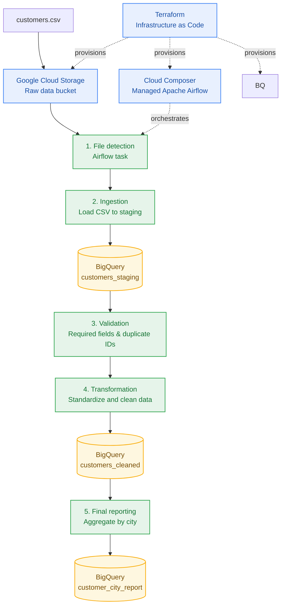
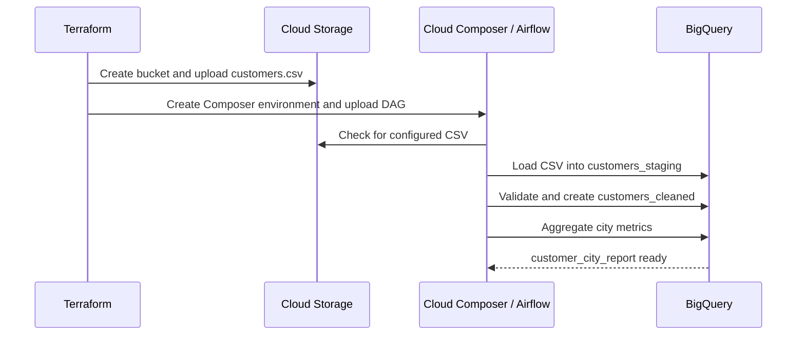

<div align="center">

# ☁️ Customer Analytics Data Pipeline on Google Cloud

### Infrastructure as Code · Workflow Orchestration · Data Quality · Analytics

**An end-to-end GCP data engineering project built with Terraform, Cloud Storage, Cloud Composer (Apache Airflow), and BigQuery.**

[](https://cloud.google.com/)
[](https://www.terraform.io/)
[](https://airflow.apache.org/)
[](https://cloud.google.com/bigquery)
[](https://www.python.org/)

**Author: Gummadi Pavan Kumar**  
*Cloud & Data Engineering Portfolio Project*

</div>

---

## 📌 Project overview

This project demonstrates a complete batch data pipeline on Google Cloud. Terraform provisions the required infrastructure, a CSV file is stored in Google Cloud Storage (GCS), Cloud Composer orchestrates the workflow with Apache Airflow, and BigQuery stores the cleaned customer data and city-level analytics.

The pipeline separates ingestion, validation, transformation, and reporting into individual Airflow tasks so that each stage can be monitored and debugged independently.

## 🏗️ Architecture



### 🔄 Workflow sequence



## ✨ What the pipeline does

| Stage | Airflow task | What happens |
|---|---|---|
| 1 | `file_detection` | Checks that the configured input CSV exists in GCS when the DAG run starts. |
| 2 | `ingestion` | Loads the CSV into the BigQuery staging table. |
| 3 | `validation` | Checks required fields and duplicate customer IDs before continuing. |
| 4 | `transformation` | Standardizes customer data and creates the cleaned table. |
| 5 | `final_reporting` | Produces city-level customer counts and salary metrics. |

The DAG is scheduled for **02:00 UTC (07:30 IST)** and can also be triggered manually. It is configured with retries for transient task failures.

## 🧰 Technology stack

- **Google Cloud Storage:** raw CSV landing zone
- **Cloud Composer / Apache Airflow:** DAG scheduling, dependencies, retries, task logs, and orchestration
- **BigQuery:** staging, cleaned customer records, and analytical reporting
- **Terraform:** repeatable infrastructure provisioning
- **Python:** Airflow DAG and data-processing logic
- **SQL:** data verification and analytical queries
- **GitHub:** source control and project documentation

## 📁 Repository structure

```text
project1-customer-analytics-pipeline/
├── dags/
│   ├── __init__.py
│   └── customer_analytics_pipeline.py
├── data/
│   └── customers.csv
├── docs/
│   ├── architecture.md
│   └── screenshots/
│       ├── airflow-dag-success.png
│       ├── bigquery-city-report.png
│       └── bigquery-cleaned-customers.png
├── sql/
│   └── verification_queries.sql
├── terraform/
│   ├── main.tf
│   ├── outputs.tf
│   ├── variables.tf
│   └── terraform.tfvars.example
├── .gitignore
├── LICENSE
├── README.md
└── requirements.txt
```

---

# 🚀 Run the project

> **Execution order:** configure and deploy infrastructure first, run the Airflow pipeline second, and verify BigQuery tables and output third.

## 1. Prerequisites

- A Google Cloud project with billing enabled. The example project ID is `gcp-data-project-510810`.
- Google Cloud CLI (`gcloud`) installed and available in PowerShell.
- Terraform installed.
- Permissions to enable APIs, create service accounts and IAM bindings, create GCS buckets and BigQuery datasets, and create Cloud Composer environments.
- Review Cloud Composer pricing before deployment; Composer can be a significant ongoing cost.

## 2. Authenticate to Google Cloud

Run from the **repository root** in PowerShell:

```powershell
gcloud auth login
gcloud config set project gcp-data-project-510810
gcloud auth application-default login
gcloud config get-value project
```

The final command should display `gcp-data-project-510810`.

## 3. Configure Terraform

```powershell
cd terraform
Copy-Item terraform.tfvars.example terraform.tfvars
```

Edit `terraform.tfvars` and confirm these values:

```hcl
project_id          = "gcp-data-project-510810"
composer_region      = "us-central1"
gcs_bucket_location  = "US"
bigquery_location    = "US"
dataset_id           = "practice"
```

Use a **globally unique** GCS bucket name. If the default bucket name is unavailable, change `bucket_name` in `terraform.tfvars`.

> `terraform.tfvars` is a local configuration file and should not be committed to GitHub. Never commit credentials, service-account keys, or Terraform state files.

## 4. Handle an existing BigQuery dataset if needed

If `practice` already exists in the project and is not already tracked by this Terraform state, import it before planning:

```powershell
terraform import google_bigquery_dataset.practice projects/gcp-data-project-510810/datasets/practice
```

Do not import it again if it is already tracked. Review any proposed changes to existing resources carefully to protect data.

## 5. Initialize, validate, plan, and apply

```powershell
terraform init -upgrade
terraform fmt -recursive
terraform validate
terraform plan
```

Review the plan. Stop if it proposes unexpected deletion or replacement of existing resources. If the plan is correct, provision the infrastructure and upload the sample CSV and DAG:

```powershell
terraform apply
```

Type `yes` only after reviewing the plan. Wait until Terraform finishes successfully; Cloud Composer provisioning can take many minutes.

## 6. Get the Airflow URL

```powershell
terraform output
```

Find `composer_airflow_uri`, open it in your browser, and sign in. In Airflow:

1. Find `customer_analytics_pipeline`.
2. Wait for the DAG to be parsed and check for import errors.
3. Trigger the DAG manually.
4. Open the run in Grid or Graph view and inspect task logs if needed.
5. Confirm all five tasks show **Success**.

## 7. Verify the BigQuery output

Open **BigQuery Studio → SQL workspace** and run the following queries after the Airflow DAG succeeds.

### Query A — City-level analytics

```sql
SELECT *
FROM `gcp-data-project-510810.practice.customer_city_report`
ORDER BY city;
```

### Expected output — City report

| city | customer_count | average_salary | total_salary |
|---|---:|---:|---:|
| Bangalore | 2 | 50000 | 100000 |
| Chennai | 1 | 35000 | 35000 |
| Hyderabad | 2 | 67500 | 135000 |

### Query B — Cleaned customer records

```sql
SELECT *
FROM `gcp-data-project-510810.practice.customers_cleaned`
ORDER BY customer_id;
```

The sample input contains **5 customer records**. Check that the cleaned table returns the expected records and that the city report contains the three sample cities above. These expected figures apply to the repository's sample CSV; results will differ if you change the input data.

You can also run the queries from [`sql/verification_queries.sql`](sql/verification_queries.sql).

---

# 📸 Execution evidence

The following screenshots were captured from the completed project run and its BigQuery verification queries.

### Airflow — successful pipeline run


### BigQuery — city-level analytics output


### BigQuery — cleaned customer records


---

## 🌍 Location configuration

| Service | Location |
|---|---|
| Google Cloud Storage bucket | `US` multi-region |
| BigQuery dataset and query jobs | `US` multi-region |
| Cloud Composer environment | `us-central1` region |

These values serve different purposes: BigQuery and GCS use the `US` multi-region, while Cloud Composer must be deployed to a specific region such as `us-central1`.

## 🛠️ Troubleshooting

- **Dataset already exists (HTTP 409):** import the existing dataset into Terraform state if it is not already tracked. Do not delete a dataset simply to resolve this error.
- **Bucket name unavailable:** select another globally unique name in `terraform.tfvars`.
- **Terraform permission errors:** verify billing, API enablement permissions, IAM permissions, and project quotas.
- **DAG not visible:** check the Composer DAGs folder, DAG import errors, and the `composer_dags_prefix` Terraform output.
- **GCS or BigQuery access denied:** check the Composer worker service account's bucket access, BigQuery job permissions, and dataset permissions.
- **Location mismatch:** keep the GCS bucket and BigQuery dataset/job location compatible; this example uses `US` for both.
- **Task failed:** open the task's Airflow logs, identify the first error, and correct that error before rerunning.

## 💰 Cost and cleanup

Cloud Composer can incur ongoing charges while the environment exists, including when the DAG is idle. Review current Google Cloud pricing before deployment and remove resources you no longer need. Before running `terraform destroy`, inspect the plan carefully: it can delete infrastructure, and resource retention settings do not replace backups. Protect any data you want to keep.

## 🔐 Security checklist

- [ ] Keep `terraform/terraform.tfvars` out of version control.
- [ ] Never commit service-account key JSON files, passwords, or tokens.
- [ ] Review screenshots and sample data before publishing publicly.
- [ ] Review IAM permissions using least privilege.
- [ ] Review Terraform plans before applying or destroying resources.

## 👨‍💻 Author

**Gummadi Pavan Kumar**  
Cloud & Data Engineering Portfolio

This project demonstrates practical skills in Google Cloud, Terraform, Apache Airflow, BigQuery, Python, SQL, data quality, and pipeline orchestration.

## 🏷️ Suggested GitHub topics

`gcp` · `google-cloud` · `terraform` · `cloud-composer` · `apache-airflow` · `bigquery` · `cloud-storage` · `data-engineering` · `etl-pipeline` · `python` · `sql`

---

<div align="center">

**Built to demonstrate an end-to-end, reproducible cloud data engineering workflow.**

</div>
