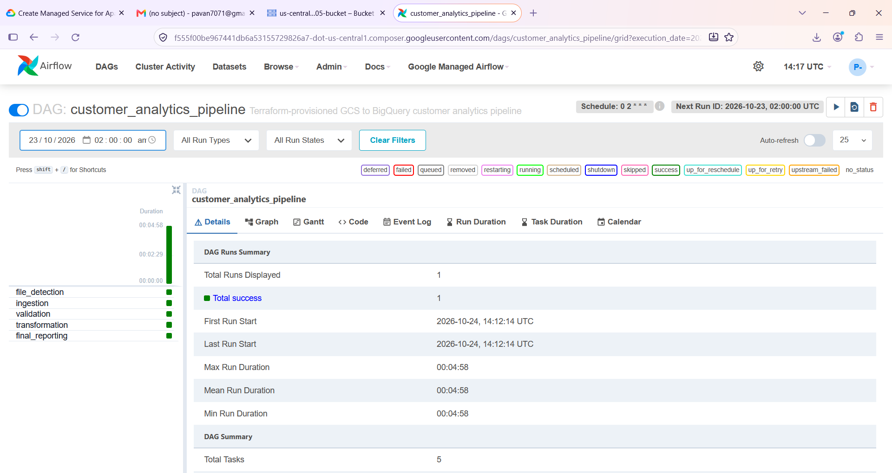
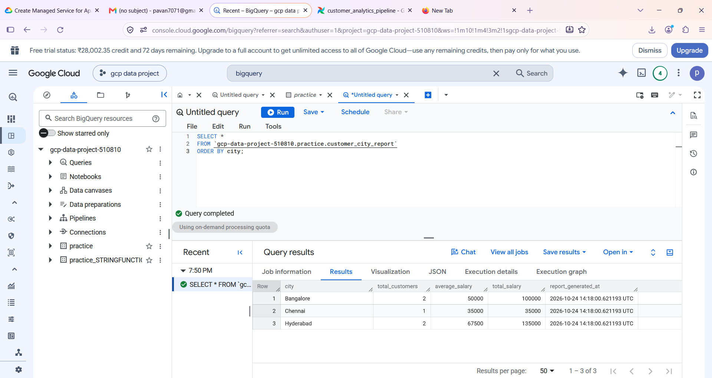
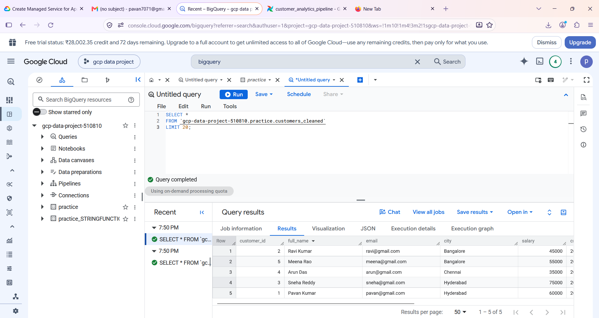

# Project 1 — Customer Analytics Data Pipeline on Google Cloud

An end-to-end GCP data engineering portfolio project. Terraform provisions the infrastructure, Cloud Composer runs an Apache Airflow DAG, Google Cloud Storage holds the source CSV, and BigQuery stores validated, cleaned data and an analytical report.

> **Project 1 intentionally does not use a GCS sensor.** The `file_detection` task checks for the configured file when a DAG run starts. The DAG runs daily at 02:00 UTC (07:30 IST) and can be triggered manually. A separate sensor-enabled version will be Project 2.

## Architecture

See [architecture and workflow](docs/architecture.md).

**Flow:** CSV in GCS → Airflow file detection → BigQuery staging → validation → transformation → city report.

## Technologies

- Google Cloud Storage (GCS)
- Google Cloud Composer / Apache Airflow 2
- BigQuery (SQL)
- Terraform / Infrastructure as Code
- Python and Google Cloud client libraries

## Pipeline tasks

1. **`file_detection`** — confirms the configured CSV exists in the raw bucket.
2. **`ingestion`** — loads CSV records into `customers_staging`.
3. **`validation`** — checks required fields, nonnegative salary, and duplicate customer IDs.
4. **`transformation`** — trims text and normalizes email addresses into `customers_cleaned`.
5. **`final_reporting`** — creates `customer_city_report` with customer count, average salary, total salary, and report timestamp by city.

## Verified execution evidence

The following screenshots were captured from the deployed project on 24 October 2026. They show one successful Airflow DAG run and successful BigQuery queries.

### Airflow — all five tasks succeeded



### BigQuery — city-level report



### BigQuery — cleaned customer data



## BigQuery output tables

Dataset: `gcp-data-project-510810.practice`

- `customers_staging` — loaded source records
- `customers_cleaned` — validated and cleaned customer data
- `customer_city_report` — aggregate report by city

Expected city-level output for the included sample CSV:

| City | Customers | Average salary | Total salary |
|---|---:|---:|---:|
| Bangalore | 2 | 50000 | 100000 |
| Chennai | 1 | 35000 | 35000 |
| Hyderabad | 2 | 67500 | 135000 |

## Run verification SQL

Open BigQuery Studio and run the queries in [`sql/verification_queries.sql`](sql/verification_queries.sql), or run these directly:

```sql
SELECT *
FROM `gcp-data-project-510810.practice.customer_city_report`
ORDER BY city;

SELECT *
FROM `gcp-data-project-510810.practice.customers_cleaned`
LIMIT 20;
```

## Repository structure

```text
project1-customer-analytics-pipeline/
├── dags/
│   └── customer_analytics_pipeline.py
├── data/
│   └── customers.csv
├── docs/
│   ├── architecture.md
│   └── screenshots/
├── sql/
│   └── verification_queries.sql
├── terraform/
│   ├── main.tf
│   ├── variables.tf
│   ├── outputs.tf
│   └── terraform.tfvars.example
├── requirements.txt
├── .gitignore
└── README.md
```

## Deploying the infrastructure (Windows PowerShell)

### Prerequisites

- Google Cloud project with billing enabled.
- Google Cloud CLI (`gcloud`), Terraform, and Git installed.
- IAM permissions to enable APIs, create service accounts, grant IAM roles, and create Cloud Composer, GCS and BigQuery resources.
- Review Cloud Composer pricing before provisioning; it can incur substantial charges.

### Authenticate

```powershell
gcloud auth login
gcloud config set project gcp-data-project-510810
gcloud auth application-default login
gcloud config get-value project
```

### Configure and validate Terraform

From the repository root:

```powershell
cd terraform
Copy-Item terraform.tfvars.example terraform.tfvars
notepad terraform.tfvars
```

Set your project ID and verify these locations: GCS `US`, BigQuery `US`, Composer region `us-central1`. Change `bucket_name` if the name is already taken (GCS names are globally unique). The local `terraform.tfvars` is excluded from Git.

If dataset `practice` already exists and is not in the current Terraform state, import it before planning:

```powershell
terraform import google_bigquery_dataset.practice projects/gcp-data-project-510810/datasets/practice
```

Then run:

```powershell
terraform init -upgrade
terraform fmt -recursive
terraform validate
terraform plan
terraform apply
terraform output
```

Review the plan for unexpected replacement or deletion before approving `terraform apply`. To run an already-deployed pipeline, open the Airflow URL from `terraform output`, locate `customer_analytics_pipeline`, and trigger a DAG run.

## Publish to GitHub

1. Create a **public or private** empty repository named `project1-customer-analytics-pipeline` (or your preferred name). Do not initialize it with a README if you will push this folder as-is.
2. From the repository root, run:

```powershell
git init
git add .
git status
git commit -m "Project 1: GCP customer analytics pipeline"
git branch -M main
git remote add origin https://github.com/YOUR_GITHUB_USERNAME/project1-customer-analytics-pipeline.git
git push -u origin main
```

Replace `YOUR_GITHUB_USERNAME` with your GitHub username. If the remote is already configured, check it with `git remote -v` and do not add it twice.

### Security checklist before pushing

- Do not commit `terraform/terraform.tfvars`, Terraform state files, service account keys, passwords, access tokens, or private customer data.
- The included CSV is synthetic sample data for demonstration.
- Review `git status` before committing.

## Cost and cleanup

Cloud Composer may continue to incur charges while running. When finished practicing, review the resources and costs in Google Cloud. Do not run `terraform destroy` blindly: it can remove infrastructure, and the project dataset/data should be protected. Review the Terraform plan and any retained resources before cleanup.

## Next project

**Project 2 — Customer Analytics Pipeline with GCS Sensor** will be a separate repository/version. It will add an Airflow GCS object-existence sensor to wait for the configured CSV while a DAG run is active. A sensor alone does not trigger a new DAG run when a file arrives; event-driven triggering can be added as a later enhancement.
