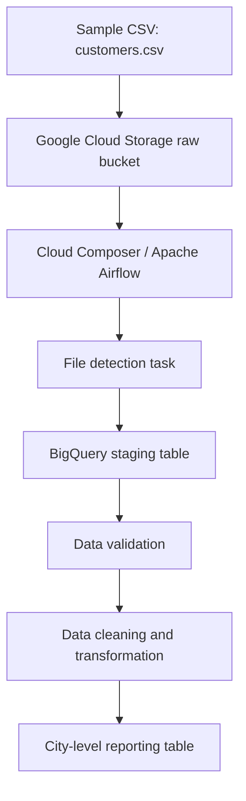

# Architecture — Project 1 (without GCS sensor)

The DAG is scheduled daily at 02:00 UTC (07:30 IST) and can also be triggered manually. The `file_detection` Python task checks whether the configured object exists during a DAG run. It is not a waiting sensor and does not automatically trigger a DAG run on upload. A sensor-based version is planned separately as Project 2.

## Main components
- **Terraform:** provisions Google Cloud APIs, IAM, Cloud Storage, BigQuery and Cloud Composer.
- **Cloud Storage:** stores the input CSV.
- **Cloud Composer / Airflow:** orchestrates the tasks.
- **BigQuery:** stores staging, cleaned and reporting tables.
